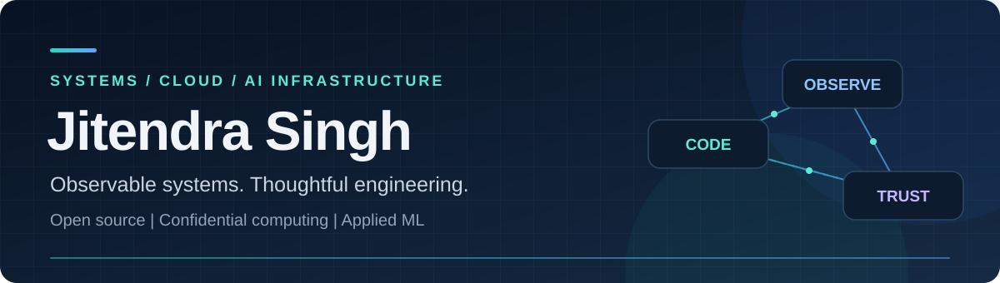

  

  <strong>Cloud-native platforms. Intelligent recovery. Reliable storage.</strong>

  <a href="#about">About</a> &nbsp;|&nbsp;
  <a href="#professional-highlights">Highlights</a> &nbsp;|&nbsp;
  <a href="#languages-and-tooling">Tech stack</a> &nbsp;|&nbsp;
  <a href="#open-source-portfolio">Open source</a> &nbsp;|&nbsp;
  <a href="#research-and-projects">Projects</a> &nbsp;|&nbsp;
  <a href="#github-achievement">Achievement</a>

## About

I'm a cloud platform and distributed systems engineer with **14+ years of experience** spanning cloud infrastructure, enterprise storage, Linux systems, and platform reliability.

My focus connects **Azure Storage resiliency, Kubernetes/OpenShift platforms, and AI-assisted operations**: turning telemetry and operational knowledge into clearer diagnosis, recovery guidance, and more autonomous infrastructure.

## Professional highlights

| Highlight | Background |
| --- | --- |
| **Microsoft Azure Storage** | Senior Software Engineer, focused on infrastructure resiliency, autonomous recovery, and AI-driven operational intelligence. |
| **Platform and storage engineering** | Previously Software Architect at IBM Research on OpenShift for IBM Z, with storage engineering experience across NetApp SolidFire and Dell EMC Data Domain. |
| **Global technical speaking** | Selected speaker at KubeCon North America, India, and Vietnam, and USENIX SREcon; themes include confidential computing, secure GitOps, and platform reliability. |
| **Innovation** | US patent work spanning replication forecasting, machine-learning-based replication estimation, and hardware/disk health prediction. |
| **AI foundation** | Master's in Machine Learning & Artificial Intelligence, complementing a systems and embedded-software background. |

## Languages and tooling

**Code**

  
  
  
  
  

**Infrastructure, research, and data**

  
  
  
  
  
  
  

**AI for infrastructure**

  
  
  

| Area | Experience and public work |
| --- | --- |
| Cloud storage and reliability | Azure Storage resiliency, distributed storage, Go, and GCSFuse contributions. |
| AI-assisted operations | AI agents, RAG-based operational intelligence, telemetry analysis, and autonomous recovery. |
| AI infrastructure | Python submissions for PyTorch custom operators, vLLM batch inference, and benchmark tooling. |
| Cloud-native platforms | Kubernetes, OpenShift, operators, Prometheus, and platform observability. |
| Container tracing | Rust submission for agent trace export in Kata Containers. |
| Storage APIs | Protocol Buffers and Go submissions covering request identity and response boundaries. |
| Trusted deployments | Kubernetes, Argo CD, Confidential Containers, and remote-attestation research. |
| Applied machine learning | Python notebooks, regression modeling, and exploratory data analysis. |

## Open-source portfolio

Selected upstream contributions and submissions. **The badges show live PR status; an open submission is not a merged contribution.**

### AI and inference infrastructure

| Project | Selected contribution | Live status |
| --- | --- | --- |
| [PyTorch](https://github.com/pytorch/pytorch) | [Tuple input annotations for custom operators](https://github.com/pytorch/pytorch/pull/204556) |  |
| [PyTorch](https://github.com/pytorch/pytorch) | [Explicit non-differentiable registration for custom operators](https://github.com/pytorch/pytorch/pull/204557) |  |
| [vLLM](https://github.com/vllm-project/vllm) | [Opt-in completion-order output for batch inference](https://github.com/vllm-project/vllm/pull/65670) |  |
| [vLLM](https://github.com/vllm-project/vllm) | [Quoted-comma support in benchmark sweep filters](https://github.com/vllm-project/vllm/pull/63469) |  |

### Storage and cloud-native infrastructure

| Project | Selected contribution | Live status |
| --- | --- | --- |
| [GCSFuse](https://github.com/GoogleCloudPlatform/gcsfuse) | [Accurate Prometheus metrics-listener logging](https://github.com/GoogleCloudPlatform/gcsfuse/pull/5229) |  |
| [GCSFuse](https://github.com/GoogleCloudPlatform/gcsfuse) | [Preserving full object identity in the shared chunk cache](https://github.com/GoogleCloudPlatform/gcsfuse/pull/5225) |  |
| [Kata Containers](https://github.com/kata-containers/kata-containers) | [Agent trace export and OTLP forwarding](https://github.com/kata-containers/kata-containers/pull/14238) |  |
| [OPI API](https://github.com/opiproject/opi-api) | [Request identity contracts for storage Create APIs](https://github.com/opiproject/opi-api/pull/508) |  |
| [OPI SPDK Bridge](https://github.com/opiproject/opi-spdk-bridge) | [Secret redaction at client-response boundaries](https://github.com/opiproject/opi-spdk-bridge/pull/896) |  |

**Merged highlight:** the GCSFuse change aligns Prometheus startup logs with the actual listener address, improving operational clarity without changing listener or scraping behavior. [Read the change and its validation](https://github.com/GoogleCloudPlatform/gcsfuse/pull/5229).

## Research and projects

### Zero-Trust GitOps

[Attestation-aware deployments with Argo CD and Confidential Containers](https://github.com/singh4jitendra/Zero-Trust-GitOps).

Research exploring how remote attestation and confidential-computing environments can inform deployment trust decisions in a GitOps workflow.

**Status:** research in progress. The public repository currently describes the proposed approach; the full implementation is not yet public.

### Applied data projects

| Project | Focus |
| --- | --- |
| [Car Price Modeling](https://github.com/singh4jitendra/Predict_Car_Price) | Multiple linear regression to study the factors affecting car prices. |
| [Loan Default Analysis](https://github.com/singh4jitendra/Predict_Loan_Defaulter) | Historical loan-applicant analysis to identify patterns associated with default risk. |
| [Investment Analysis](https://github.com/singh4jitendra/Investment-Analysis) | Comparing sectors, countries, and investment types against a defined investment brief. |

### Systems foundations

Learning projects include [C memory-allocation experiments](https://github.com/singh4jitendra/OWN_MALLOC) using `sbrk`, `mmap`, and `munmap`, alongside [C++ coding practice](https://github.com/singh4jitendra/Coding-Practice).

## GitHub achievement

  
   
  <strong>Arctic Code Vault Contributor</strong>
   
  <a href="https://github.com/singh4jitendra?tab=achievements">View my public GitHub achievements</a>

## Current interests

- AI-assisted incident analysis, recovery guidance, and autonomous fleet operations.
- Reliable distributed storage and cloud-native platform architecture.
- Observability that accurately reflects runtime behavior.
- Storage API contracts, predictable retries, and clear response boundaries.
- Attestation-aware deployment workflows and confidential workloads.
- Practical systems programming and interpretable data analysis.

---

  <a href="https://github.com/singh4jitendra?tab=repositories"><strong>Explore my repositories</strong></a>
  &nbsp;|&nbsp;
  <a href="https://github.com/search?q=author%3Asingh4jitendra%20is%3Apr&amp;type=pullrequests">Follow my upstream work</a>

